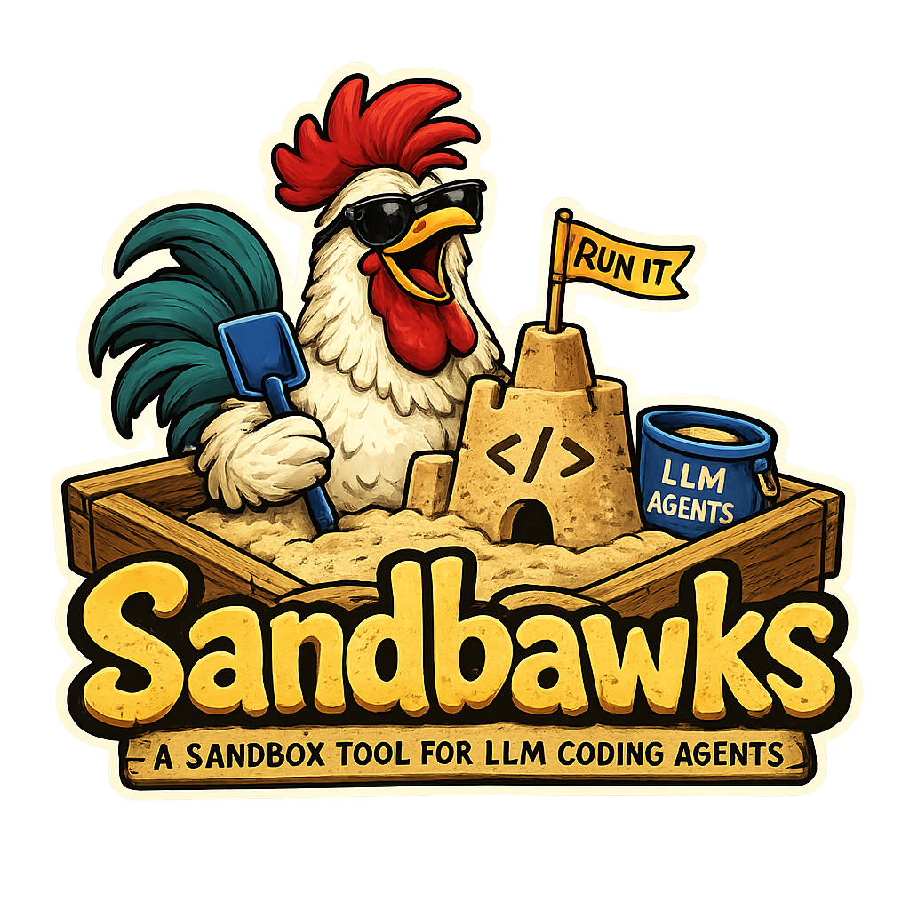

## Documentation

API documentation for the workspace crates is generated by
`cargo doc --workspace --no-deps` and published to GitHub Pages from CI on
every push to `main` (`.github/workflows/docs.yml`). The landing page lists
every workspace crate.

## Project history

sandbawks was developed on a private forge before being open-sourced here.
Issue and pull-request numbers (`#N`) in code comments, `changelog/` and
`docs/` refer to that earlier tracker, not to this repository's issues.

## License

Licensed under the [Apache License, Version 2.0](LICENSE).
